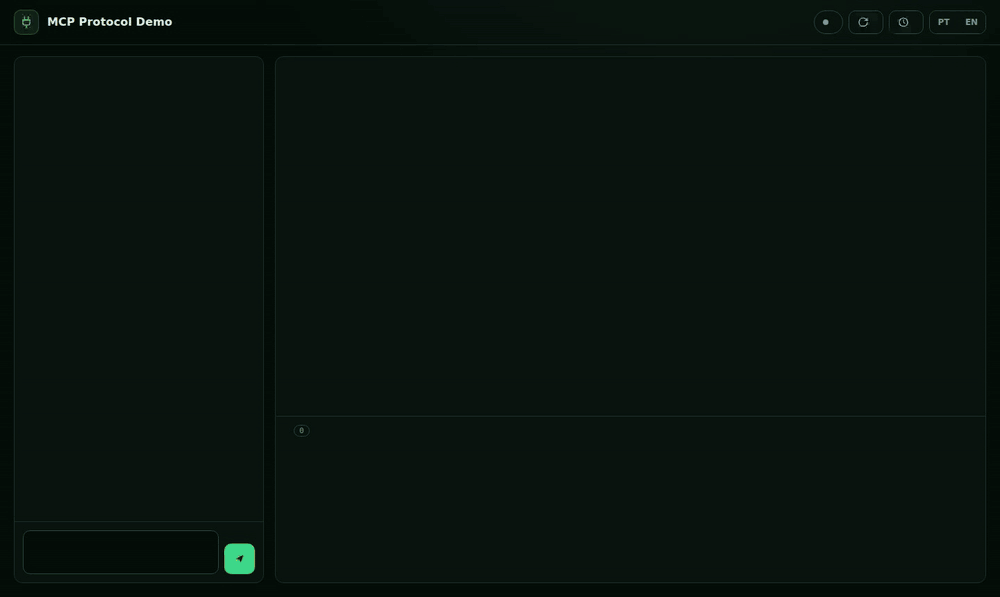

<div align="center">

# 🔌 mcp-protocol-demo

### A plant-care chatbot whose agent **discovers** two MCP servers, turns their tools into functions for the LLM and **routes every call** to the server that owns it — drawn live on screen.

<br />

[](https://www.python.org/)
[](https://modelcontextprotocol.io)
[](https://platform.openai.com/)
[](#)


<br />



</div>

---

## ✨ What it shows

- 🚀 **The boot, step by step** — the agent starts knowing only two URLs; `server/discover` negotiates the protocol version, `tools/list` tells what each server can do, and every MCP tool becomes a plain function in the agent's registry
- 🧠 **The decision** — the LLM sees 5 functions and **has no idea they live on MCP servers**; it only names the function, the host is the one that calls
- 🧭 **The routing** — the host looks the function up in its registry, finds the owning server and sends `tools/call` there; when the LLM asks for several at once, they run in parallel, on different servers
- 📡 **The real wire** — every step expands to the actual JSON-RPC request/response and the mirrored HTTP headers (`Mcp-Method`, `Mcp-Name`, `MCP-Protocol-Version`), captured from the HTTP client, not reconstructed
- 🛑 **Three kinds of failure, three audiences** — a business refusal (`isError`) goes back to the LLM, a crash keeps its text on the server, a server that is down is told to the user by code
- 🌎 UI in **PT · EN**; the agent answers in whatever language you write

## 🧩 The pieces

```mermaid
flowchart LR
    UI["🖥️ Web UI<br/>chat + live workflow"] -->|"HTTP"| HOST["🤖 Agent · Fern<br/>MCP host"]
    HOST <-->|"Chat Completions<br/>5 function definitions"| LLM["✨ LLM<br/>gpt-6-luna"]
    HOST ==>|"MCP · Streamable HTTP"| G["🌿 garden<br/>MCP server :8001"]
    HOST ==>|"MCP · Streamable HTTP"| W["🌧️ weather<br/>MCP server :8002"]

    style HOST fill:#0d1b14,stroke:#3ddc8a
    style LLM fill:#1f1a0c,stroke:#f2c14e
    style G fill:#121c0c,stroke:#a3e05a
    style W fill:#0b1820,stroke:#5ec6f2
```



| Server | Tools | Owns |
|---|---|---|
| **garden** | `list_plants` · `get_care_guide` · `log_watering` (write) | the user's plants and their watering log |
| **weather** | `get_current_weather` · `get_forecast` | a (simulated, deterministic) forecast: rain today, a hot dry day tomorrow |

The hero question — *"Do I need to water anything today?"* — needs **both** servers: the plants that are due (garden) and whether today's rain covers the outdoor ones (weather).

## 🎬 The flow

```mermaid
sequenceDiagram
    participant H as Agent (host)
    participant G as garden
    participant W as weather
    participant L as LLM
    Note over H,W: Boot — the agent knows only two URLs
    H->>G: server/discover
    G-->>H: 2026-07-28 · capabilities · instructions
    H->>G: tools/list
    G-->>H: 3 tools (name, description, JSON Schema)
    H->>W: server/discover · tools/list
    W-->>H: 2 tools
    Note over H: 5 MCP tools → 5 functions in the registry
    Note over H,L: A message — "Do I need to water anything today?"
    H->>L: conversation + 5 function definitions
    L-->>H: tool_calls: list_plants, get_forecast
    par the host routes each call to its owner
        H->>G: tools/call list_plants
        G-->>H: 5 plants, due_in_days computed in code
    and
        H->>W: tools/call get_forecast
        W-->>H: 14 mm of rain today
    end
    H->>L: the two results
    L-->>H: "Water the fern; the rain covers the balcony."
```

## 🧠 MCP in five ideas (what the demo makes visible)

1. **MCP does not replace function calling — it feeds it.** `tools/list` returns the same three pieces a function definition has (name, description, JSON Schema). The host wraps them in the LLM provider's format ([`host/agent.py`](host/agent.py), `RegisteredTool.definition`). The LLM never learns a tool is remote.
2. **Host ≠ client ≠ server.** The *host* (the agent) owns the conversation and the LLM; it runs one *client* per *server*. The servers own the tools **and their data** — the agent never touches `servers/*/data.py`.
3. **Discovery is the host's job, done once at boot.** A tool a server adds later shows up on the next boot ("Restart agent"). Two servers publishing the same tool name **fails the boot** — otherwise one would silently shadow the other.
4. **The 2026-07-28 protocol is stateless; the client isn't.** No `initialize` handshake, no session: each request is one POST that carries its protocol version. But the SDK's client caches what discovery taught it (each tool's `outputSchema`) — a fresh client per call sends an **extra `tools/list` after every `tools/call`** to learn it again. So one client lives per server, from boot to shutdown ([`host/mcp_client.py`](host/mcp_client.py)).
5. **Errors have audiences.** `ToolError("already logged today")` comes back as a result with `isError: true` — written *for the model*, which explains it to the user. Any other exception is a crash: the SDK keeps its text on the server. A server that is down is a `ServerUnavailable` for *our code*, which tells the user — handing it to the LLM as text would get an invented excuse.

## 🚀 Run it

```bash
cp .env.example .env              # set OPENAI_API_KEY
./start.sh                        # garden :8001 · weather :8002 · UI → http://127.0.0.1:8080
```

Or one process per terminal: `python -m servers.garden`, `python -m servers.weather`, `python -m host`.

Try: *"Do I need to water anything today?"* → *"I just watered the fern"* → *"I just watered the fern"* again (a business refusal) → *"How do I care for my fern?"*. **Slow motion** slows the animation down for recordings. Restarting the servers resets the plants.

## 🧪 Tests

```bash
.venv/bin/python -m pytest -q
```

No LLM involved: both MCP servers run for real over HTTP (background threads, free ports) and a scripted model ([`tests/fake_llm.py`](tests/fake_llm.py)) stands in for the LLM. They cover discovery, parallel calls on two servers, one POST per call after discovery, writes, business refusals, schema validation on the server, unknown tools, name collisions and servers that are down — at boot and mid-chat.

## 📁 Structure

```
servers/
  common.py              # how a server is served: Streamable HTTP, stateless, JSON responses, 127.0.0.1
  garden/                # server.py (MCPServer + @tool) · data.py (its own data)
  weather/               # server.py · data.py
host/
  mcp_client.py          # one MCP client per server: discover, call, observe the wire (for the UI)
  agent.py               # the host: boot → registry → LLM loop → route each call to its server
  llm.py                 # OpenAI Chat Completions behind one async function
  app.py  events.py      # web API + SSE event stream the UI animates
web/                     # vanilla HTML/CSS/JS, no build step: flow.js (diagram), steps.js, chat.js
tests/                   # real servers over HTTP + scripted LLM
```

## 🙈 What this demo skips (on purpose)

- **Authentication.** Both servers trust whoever reaches them, so they only listen on `127.0.0.1`. A real deployment puts an OAuth token on every request (the SDK has `TokenVerifier` for the server side) and never lets the LLM choose *who* the user is.
- **Resources, prompts, elicitation, progress.** Only tools — the part every MCP host uses. Elicitation (the server asking the user a question mid-call) and progress (which needs SSE instead of `json_response`) are the natural next steps.
- **Tool overload.** With 5 tools, sending all of them to the LLM is fine. With hundreds, a host needs per-agent allowlists or on-demand tool loading — MCP makes plugging in servers easy, which makes this problem *worse*, not better.
